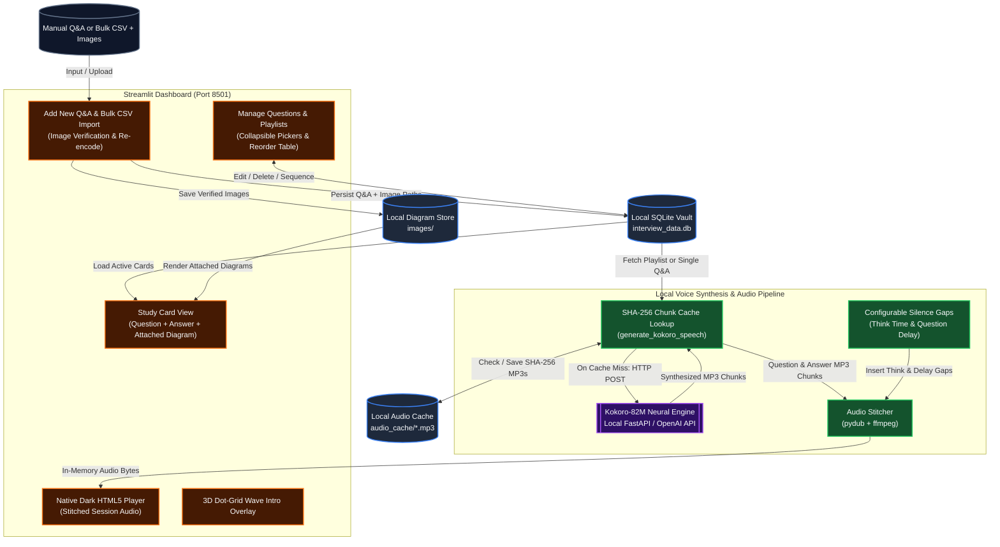

# Sonorius

**Local Voice-Assisted Q&A & Interview Prep · by Rabbit Knight**

**Turn your static study notes into a realistic, two-voice spoken rehearsal session, locally and privately.**

**Sonorius** is a local voice rehearsal and study app for any subject: coursework, exams, presentations, or interviews. Build a Question & Answer vault (manually or via Bulk CSV), attach images or diagrams, and practice with the local neural voice engine. Set separate voices for the question and answer, add think-time pauses to answer out loud before hearing the solution, and sequence custom playlists without sending data to the cloud.

## App Overview

https://github.com/user-attachments/assets/0274b850-5e88-4283-802f-b1b372a322fc

---

## How It Works

> **Workflow Overview:**
> - **Build Your Vault (Manual or Bulk CSV):** Add Question & Answer pairs in the **Add New Q&A** form, or import them in bulk using a 3-column CSV (`Question`, `Answer`, `Image`) with your reference diagrams (`.png`, `.jpg`, `.jpeg`, `.webp`).
> - **Two-Voice Sessions & Playlists:** Create custom playlists (or drill a single question), choose voices for the **Interviewer** (reads the question) and **Candidate** (reads your answer), and set your **Think Time** pause, **Next Question Delay**, and speed.
> - **Practice & Review Visually:** When you press **Play**, Sonorius stitches the session into a single audio track (cached locally on disk for faster replay) while displaying the question card, answer card, and attached diagram on screen.
> - **What It Does NOT Do:**
>   - It does **not** ship with pre-made question banks or built-in diagrams.
>   - It does **not** automatically extract Q&As from unstructured text files, PDFs, or raw notes.
>   - It does **not** use an LLM to invent answers, and it does **not** record or grade your microphone audio. You stay in complete control of your material.

---

## Why Sonorius?

Reading notes silently does not train you to answer questions out loud under pressure.

Existing flashcard and cloud tools have common pain points:
1. **Constant manual clicking:** Traditional flashcard tools force you to click a speaker icon on every single card instead of flowing through a full multi-question rehearsal session.
2. **Cloud privacy risks:** Pasting personal study notes, presentation scripts, or private work material into cloud TTS services uploads your data to third-party servers.
3. **No built-in "Think Time":** Active recall and verbal practice require a moment to think or speak your response out loud before hearing the answer. Sonorius lets you configure pauses from 1s up to 120s (2 minutes), or 0s for continuous listening.

**Sonorius runs the entire workflow locally on your own machine.**

Everything runs locally with SQLite (`0600` private permissions) and your local TTS server. The UI loads Google Fonts (Inter, DM Mono, Material Symbols Rounded) from `fonts.googleapis.com` in the browser; none of your study data is sent there. Offline, the app still works, but text uses fallback fonts and some icons appear as plain words. All question, answer, and audio processing is 100% local. Once a question or playlist is synthesized, SHA-256 audio caching skips re-synthesis on repeat plays for much faster replay (editing or deleting a question clears `audio_cache/`; adding questions keeps it).

---

## Architecture & Data Flow

Data flow across storage, audio synthesis, and the web interface:



---

## Core Features

- **Local & Private:** Runs entirely on your local machine or server with zero external API calls for your data or audio, zero analytics, and zero cloud telemetry. Your questions, answers, notes, and images remain strictly private.
- **Dual-Voice Conversational Practice:** Uses selectable neural voices for the **Interviewer** asking questions and the **Candidate** reading your curated answers.
- **Continuous Playlist Playback:** Pre-stitches entire playlists into a single audio session with server-generated silence gaps, removing the need to manually click play after each question.
- **Customizable Think-Time Pauses & Delays:** 
  - Configure a **Think Time** pause between the question and the answer to articulate your response aloud under realistic pressure, or turn off the pause for continuous, back-to-back playback.
  - Adjust the **Next Question Delay** between items to control the pacing of your session.
- **Optional Image & Diagram Display:** If you attach an image or diagram (`.png`, `.jpg`, `.jpeg`, `.webp`) to a question, Sonorius displays it below the Question and Answer cards so you can view your visual aid while listening.
- **High-Fidelity Kokoro Neural TTS:** Uses the lightweight yet human-quality Kokoro-82M neural TTS engine with multiple voice styles and adjustable playback speed.
- **Audio Hash Caching:** Every synthesized speech chunk is cached locally in `audio_cache/` using SHA-256 hashes of the text, voice, and speed. Replaying playlists is much faster with zero TTS re-synthesis overhead. Editing or deleting any question clears `audio_cache/` (adding questions keeps existing cached clips).
- **Visual Checklist Playlist Builder:** Build and reorder playlists using a scrollable checkbox picker with search filtering, Select All / Deselect All buttons, and an interactive numeric reordering table.
- **Bulk CSV Import with Pre-flight Validation:** Import questions and referenced diagrams with automatic schema mapping, duplicate safety, and preview.
- **Collapsible Management:** Expandable sections for Question Vault, Edit Question, Batch Question Deletion, Create Playlist, Edit Playlist, and Batch Playlist Deletion.

---

## Quick Start Guide

When you use Sonorius, two local services run on your computer at the same time and communicate over `localhost`:

```text
┌─────────────────────────────────────────────────────────────────────────────┐
│                              YOUR COMPUTER                                  │
│                                                                             │
│  1. WEB BROWSER           2. SONORIUS APP             3. KOKORO CONTAINER   │
│  (http://localhost:8501)  (Port 8501)                 (Port 8880)           │
│                                                                             │
│  You click "Play"  ────►  Reads your Question &  ───► Converts text into    │
│  in the UI                Answer from SQLite          spoken MP3 audio      │
│                                    ▲                         │              │
│  Plays the session ◄────  Stitches MP3 clips     ◄───────────┘              │
│  in your browser          and pauses together                               │
└─────────────────────────────────────────────────────────────────────────────┘
```

1. **Kokoro Voice Container (`http://localhost:8880`):**
   - Running the Podman or Docker command starts the Kokoro-82M neural TTS engine in the background on port `8880`, where it waits for text requests and returns spoken MP3 audio.
2. **Sonorius Application (`http://localhost:8501`):**
   - Running `./run_app.sh` inside the Sonorius folder starts the web interface on port `8501`.
3. **Local Connection:**
   - The default endpoint `http://localhost:8880/v1/audio/speech` is preconfigured in `app.py`. No manual linking or `.env` file is required when both services run on the same computer - clicking **Play** at `http://localhost:8501` automatically sends your text to port `8880`, stitches the returned audio and pauses, and plays the session in your browser.

---

### Step 1. Start the Local Voice Engine (Kokoro)
Make sure you have **Podman** or **Docker** installed, then start the Kokoro voice container:

- **First time only** (downloads and starts the voice engine in the background):
  ```bash
  # Using Podman:
  podman run -d --name kokoro-tts -p 8880:8880 ghcr.io/remsky/kokoro-fastapi-cpu:latest

  # Or using Docker:
  docker run -d --name kokoro-tts -p 8880:8880 ghcr.io/remsky/kokoro-fastapi-cpu:latest
  ```
- **Next time you restart your computer** (turns the existing voice container back on):
  ```bash
  # Using Podman:
  podman start kokoro-tts

  # Or using Docker:
  docker start kokoro-tts
  ```
*(See [docs/VOICE_SETUP.md](docs/VOICE_SETUP.md) for verification and links to upstream native Python and GPU setup).*

---

### Step 2. Install Sonorius (One-Time Setup)
Requires **Python 3.10–3.12** (tested on Python 3.12; FFmpeg is handled automatically on first run via `static-ffmpeg` - no manual installation needed. *Note: On Python 3.13+, `pydub` requires the `audioop-lts` package because `audioop` was removed from the standard library. If you use Python 3.13+, install `audioop-lts` or add `audioop-lts; python_version>="3.13"` to `requirements.txt`.*)

Clone this repository and install the Python packages into a virtual environment:

```bash
git clone https://github.com/The-Rabbit-Knight/Sonorius.git
cd Sonorius

# Linux / macOS:
python3 -m venv .venv
source .venv/bin/activate

# Windows (PowerShell):
# python -m venv .venv
# .venv\Scripts\Activate.ps1

pip install --upgrade pip
pip install -r requirements.txt
```

---

### Step 3. Run Sonorius

#### Option A: On Your Computer (Default & Recommended)
- **Linux / macOS (or Windows via WSL2 / Git Bash):**
  ```bash
  chmod +x run_app.sh
  ./run_app.sh
  ```
  Open your browser at **`http://localhost:8501`** (or `https://localhost:8501` if you configured `mkcert` / custom TLS certificates).
- **Windows (PowerShell / Command Prompt, localhost only):**
  ```powershell
  .venv\Scripts\Activate.ps1
  streamlit run app.py
  ```
  Open your browser at **`http://localhost:8501`** (`.streamlit/config.toml` locks `streamlit run` to `localhost` by default).

> **Your First 60 Seconds in the App:**
> When you first open `http://localhost:8501`, your question vault starts empty. To try it out right away:
> 1. Click **Add New Q&A** in the left sidebar.
> 2. Either type a question & answer, **or** open **Bulk Import Questions via CSV** and upload `bulk_import/questions_template.csv` (along with `bulk_import/images/Sonorius_image.jpeg`) to load 7 starter questions in one click.
> 3. Click **Play Session** in the left sidebar, switch **Playback Mode** to **Single Question** (or create a playlist under **Manage Playlists**), and click **Play Single Question** / **Play Playlist**.

#### Option B: Local Network Access (Second Computer on the Same Network)
If you want to practice from another computer on the same local network:
```bash
./run_app.sh --lan
```
- **Automatic HTTPS Encryption:** The script automatically generates a local TLS certificate (in `.certs/`) so your Q&As and audio streams are encrypted over the network.
- **Simultaneous Dual Access:** 
  - On this computer: Open **`http://localhost:8501`**
  - On the other device: Open **`https://<your-computer-ip>:8501`** (plain `http://` from another device is blocked)
- **Certificate warning is expected:** The generated certificate is issued for `localhost`, not for your computer's LAN IP. The other device's browser will show a security warning (choose **Advanced → Proceed**), and the address bar will keep showing **"Not Secure"** even after you proceed. The connection is still TLS-encrypted; the warning only means the browser cannot verify the certificate's identity.
- *(Note: The interface is designed for desktop/laptop screens. It will load in a mobile browser over HTTPS, but the layout is not optimized for small screens.)*

---

### Optional: Custom `.env` Configuration (Advanced / Remote TTS)

You only need a `.env` file if your Kokoro TTS server runs on a custom port, a different machine on your network, or if you want custom TLS certificates:

```bash
cp .env.example .env
```

Edit `.env` as needed (see `.env.example` for all options):
```bash
# URL to OpenAI-compatible TTS endpoint
KOKORO_TTS_URL="http://localhost:8880/v1/audio/speech"
```

---

## User Interface & Workflow

### 1. Play Session
- **Playback Modes:** Switch between practicing an entire curated **Playlist** or drilling a **Single Question**.
- **Dual Voices & Timing Tuning:** In the sidebar **Preferences** expander, select voices for the **Interviewer** and **Candidate**, adjust playback speed, configure **Think Time** (including continuous playback with no pause), and set the **Next Question Delay** between items. Use **Save Preferences** to persist your choices in SQLite.
- **Session Player:** Click **Play Playlist**. Sonorius generates the audio, renders the continuous player, and opens the visual flashcard deck. Use **Next** / **Previous** to review diagrams and your curated responses.

### 2. Add New Q&A
- **Manual Form:** Quickly input a question, your curated answer text, and attach an optional image or diagram (`.png`, `.jpg`, `.jpeg`, `.webp`).
- **Bulk Import via CSV:** Expand **Bulk Import Questions via CSV** to upload `.csv` spreadsheets containing dozens or hundreds of questions. Attach diagrams in bulk, preview the first 5 rows, and commit directly to the vault.

### 3. Manage Playlists
- **Organized in Two Dedicated Sections:**
  - **Manage Questions:**
    - **Question Vault:** Fixed-height, scrollable table with real-time keyword filtering.
    - **Edit an Existing Question:** Update question text, answer notes, or replace/remove diagrams.
    - **Delete Questions from Vault:** Scrollable checkbox list with **Select All** / **Deselect All** buttons to delete multiple questions and their media files in a single click.
  - **Manage Playlists:**
    - **Create New Playlist:** Pick questions visually via a scrollable checklist picker, rearrange play order using an interactive numeric reordering table, and save with a custom name.
    - **Edit an Existing Playlist:** Rename or adjust question order and selections for any existing playlist.
    - **Delete Existing Playlists:** Batch checkbox selector to delete playlists without removing questions from the vault.

---

## Limitations & Technical Prerequisites

1. **Requires the Background Voice Container (Kokoro-82M):** Sonorius does not bundle the AI voice model inside `app.py` itself - the Kokoro container (`http://localhost:8880`) must be running in the background when synthesizing new questions.
2. **Text-to-Speech Only (No Generative LLM):** Sonorius voices **your** input questions and **your** reference notes. It does not generate text dynamically or grade your verbal responses via speech-to-text.
3. **First-Play Synthesis Time:** When generating audio for a brand-new playlist, Kokoro must synthesize each speech chunk. On CPU, a 10-question playlist may take 10–25 seconds to generate. Once synthesized, audio chunks are cached on disk so repeat plays skip re-synthesis and run much faster.
4. **LAN Self-Signed Certificates:** When running across a local network with `./run_app.sh --lan`, browsers require you to accept the self-signed TLS certificate once before audio streaming and secure WebSockets (`wss://`) will connect.

---

## CSV Bulk Import Format

To import multiple questions at once, use the following CSV structure (a template is available in `bulk_import/questions_template.csv`):

| Question | Answer | Image |
| :--- | :--- | :--- |
| `What is Sonorius and how does it help preparation?` | `Sonorius is an offline-first, voice-assisted study and rehearsal platform. You can practice actively with a custom think-time pause...` | `Sonorius_image.jpeg` |
| `How does the two-voice dialogue work?` | `In the sidebar under 'Preferences', Sonorius allows you to configure a two-voice dialogue...` | |

- **Question** *(Required)*: The question prompt.
- **Answer** *(Required)*: Your curated reference answer.
- **Image** *(Optional)*: Filename of an image placed in `bulk_import/images/` or uploaded concurrently via the web uploader.

*(See [docs/BULK_IMPORT_GUIDE.md](docs/BULK_IMPORT_GUIDE.md) for formatting tips and sample scripts).*

---

## Project Structure

```
Sonorius/
├── .env.example               # Template environment configuration
├── .gitignore                 # Git ignore rules for vault, media, and caches
├── .streamlit/
│   └── config.toml            # Dark theme & localhost-only server binding
├── LICENSE                    # MIT License
├── README.md                  # Platform documentation
├── requirements.txt           # Python dependencies
├── run_app.sh                 # Application launcher script (local HTTP & TLS setup)
├── tls_proxy.py               # Dual HTTP/HTTPS socket multiplexer for --lan / --https
├── intro_audio.mp3            # Brand intro audio for dot-grid wave
├── app.py                     # Main application, database logic, & UI engine
├── bulk_import/
│   ├── README.md              # Guide for bulk CSV ingestion
│   ├── questions_template.csv # Clean starter CSV template
│   └── images/                # Default directory for bulk diagrams
├── docs/
│   ├── ARCHITECTURE.md        # Technical design, schemas, & audio pipelines
│   ├── VOICE_SETUP.md         # Guide for configuring local Kokoro TTS
│   └── BULK_IMPORT_GUIDE.md   # Advanced CSV importing and playlist curation
├── images/                    # Local storage for user-uploaded diagram files
└── tests/
    └── test_sonorius.py       # Automated test suite (DB, security, audio, UI)
```

---

## Privacy & Security Considerations

1. **Local-Only Storage:** All data is stored in SQLite (`interview_data.db`). On startup, permissions are locked to `chmod 0600` (readable and writable only by your local user account).
2. **Zero Cloud Dependencies:** TTS synthesis calls an HTTP endpoint under your direct control (default `127.0.0.1:8880`). No voice samples, questions, or answers are ever uploaded to cloud providers.
3. **Clean Media Isolation:** Uploaded diagrams are assigned cryptographically random UUID filenames (`uuid.uuid4().hex`) to avoid path collisions and are deleted from disk whenever a question is removed.

---

## Disclaimer & Limitation of Liability

Sonorius is an open-source personal project provided on an **"AS IS"** and **"AS AVAILABLE"** basis for personal study and practice purposes only. It is **not enterprise software**, commercial SaaS, or a certified secure vault.

- **No Security Warranty:** While the application incorporates local-first safeguards (such as loopback binding, strict file permissions, and payload validation), the author provides **no guarantee or warranty** regarding absolute security, confidentiality, or immunity from vulnerabilities, misconfigurations, or data interception.
- **Scope of "100% Local":** "100% local" refers to your study data (questions, answers, images, playlists) and audio synthesis, which never leave your machine or your own TTS server. Optional third-party resources (Google Fonts loaded by the browser, and a one-time FFmpeg download if no system FFmpeg is installed) do not receive any of your data.
- **User Responsibility:** Users are solely responsible for securing their own host environment, network configurations, operating system file access, firewall rules, and third-party dependencies.
- **Zero Liability:** Under no circumstances shall the author or contributors be liable for any direct, indirect, incidental, special, or consequential damages (including unauthorized data exposure, data loss, security breaches, network sniffing, system compromise, or study, exam, presentation, or interview outcomes) arising from the installation, use, or misuse of this software.

---

## Author & License

Crafted by **Rabbit Knight** as part of the local-first private tooling suite.  
Released under the **MIT License** (see [LICENSE](LICENSE)).
